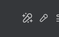
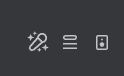

# Hide Lyrics Button

Spicetify extension that hides Spotify's native **Lyrics** button while leaving **Spicy Lyrics** buttons visible.

## Preview

Before:



After:



## Installation

Copy `hide-lyrics-button.js` to Spicetify's `Extensions` directory and enable it with:

```powershell
spicetify config extensions hide-lyrics-button.js
spicetify apply
```

## How it works

The extension targets Spotify's native button using `button[data-testid="lyrics-button"]`. It does not target buttons whose IDs begin with `SpicyLyrics_`.

## License

MIT
